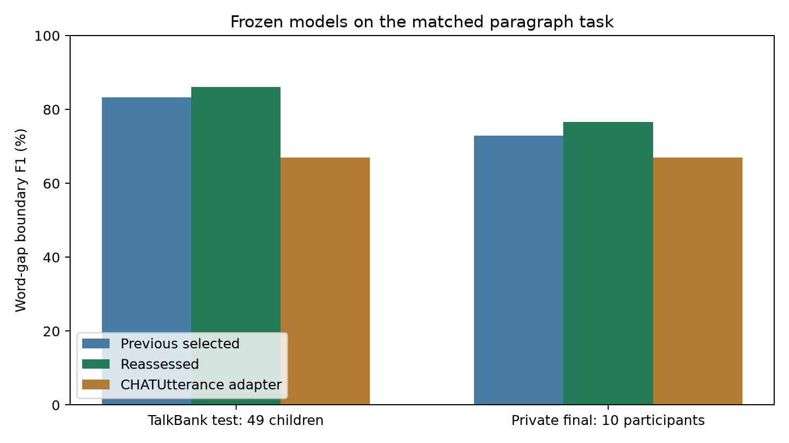
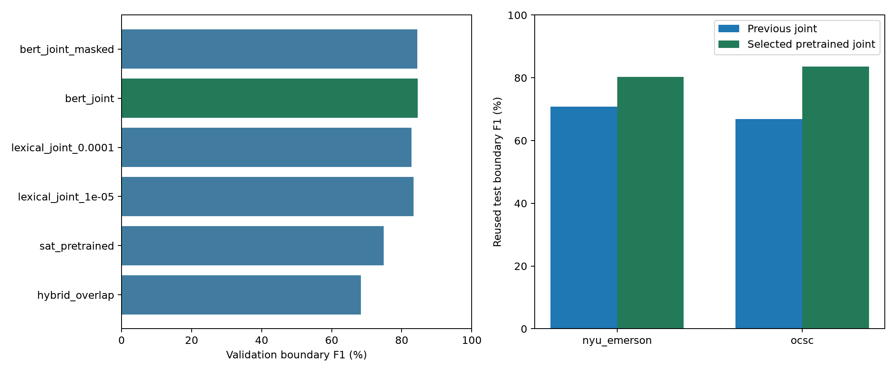
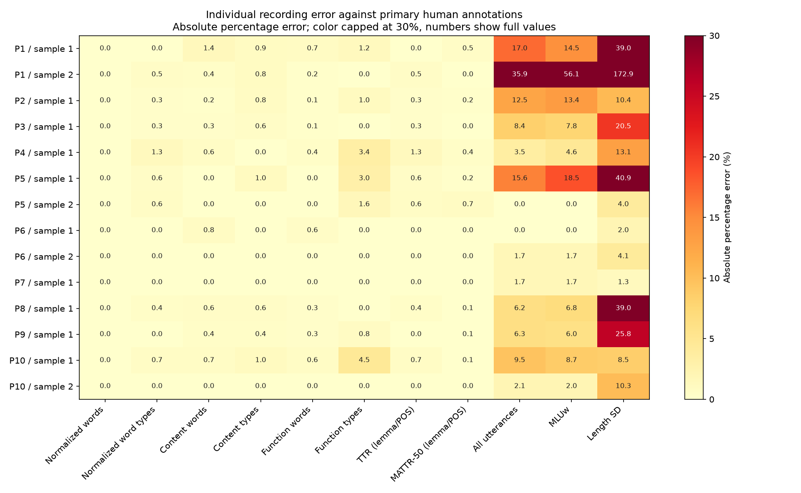
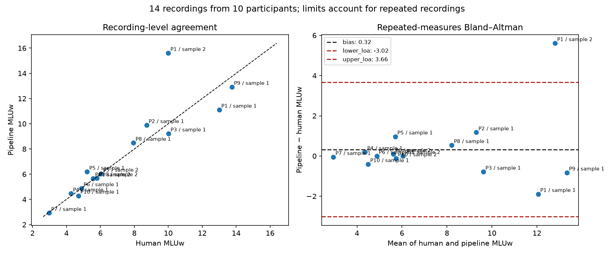
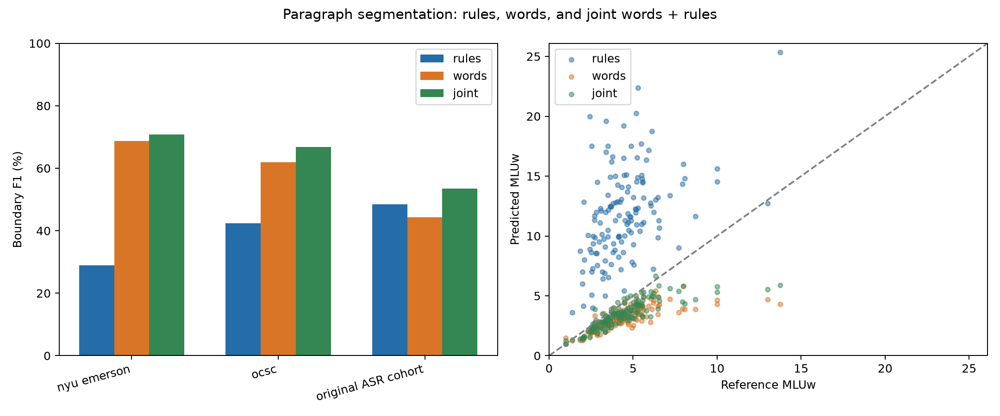

# Speech validation and paragraph segmentation

## Metric-first paragraph development

The user confirmed CLAN/CHAT utterance units and clarified that low final language-measure error is the goal; a 90% boundary score is not the acceptance criterion. Audio work is deferred. This round processes unpunctuated target-speaker transcript paragraphs, with human CHAT formatting withheld. The original 233/49/49 public child partitions are retained; test and all 10 original participants are final evaluation only.

Candidate selection minimizes the equally averaged count, surface MLUw and population length-SD absolute percentage errors, first averaging recordings within each child, then children within each corpus, then equally weighting the two public corpora. Zero-reference denominators are unavailable rather than zero-filled. This is a declared development objective, not a claim that every metric improves. Boundary precision/recall/F1 and exact spans remain separate diagnostics of agreement with human units.

Published automated and human comparisons are documented in the [research review](../../../speech_pipeline/research/SEGMENTATION_RESEARCH.md#human-comparisons-and-metric-first-benchmarks-verified-october-15-2026), with sourced numerical records in [literature_benchmarks.json](../../validation/benchmark/literature_benchmarks.json). Different populations, input stages, annotation units and aggregation prevent a direct ranking. Human percent agreement, consistency ICC, transcription WER, boundary F1 and downstream metric errors are distinct quantities.

Larger DeBERTa and RoBERTa encoders, metric-oriented count supervision, training-only token corruption, corpus-balanced sampling and independent automatic spaCy sentence cues are compared. Every model still learns human boundary labels. Neither inference nor postprocessing receives gold utterance lengths/counts. No predicted cut is forced to satisfy a reference metric. The MOSS implementation is not present and is not claimed to have run. Transformer training and inference use local MPS when available, with CPU fallback.

| Public-validation candidate | Status | Composite metric error (lower better) | Boundary F1 diagnostic |
| --- | --- | ---: | ---: |
| incumbent | complete | 17.32% | 86.83% |
| deberta_context | complete | 15.33% | 88.09% |
| deberta_metric | complete | 14.85% | 87.60% |
| roberta_metric | complete | 15.96% | 86.28% |
| minilm_metric | complete | 9.23% | 85.72% |
| deberta_sentence | complete | 14.66% | 87.54% |
| chat_metric | complete | 16.05% | 84.71% |

The user required a five-minute finish. The remaining DeBERTa moments training was interrupted and excluded before final evaluation; seven completed candidates remained eligible. The original registration and amendment are preserved in the protocol.

The new selected pipeline has now been run and audited on all 74 recording-condition outputs (37 ASR and 37 corrected recordings), including exact agreement with all 14 frozen private predictions, source-word preservation, 17 TAALED comparisons per recording and actual CLAN agreement within displayed precision. The separate public-test downstream lexical comparison stage remains pending; do not infer it from these original-cohort checks.

The frozen public-validation selection was **minilm_metric**. Selection and production bundle were saved before opening final records. Final transformer inference device: `mps`.

The following is the declared composite metric-error objective, in mean APE percentage points. Public children are averaged within corpus before equally weighting corpora; the original cohort has one corpus. Lower is better.

| Final scope | Previous MiniLM | Selected model | Change |
| --- | ---: | ---: | ---: |
| Public test | 17.91 | 16.09 | -1.83 |
| Original participants | 30.31 | 29.60 | -0.71 |

Available recording-level APE pairs are shown explicitly. Zero reference denominators and unavailable predictions are excluded from the corresponding error average; they are not filled with zero error.

| Scope / model | Paragraphs | Count APE pairs | MLUw APE pairs | SD APE pairs |
| --- | ---: | ---: | ---: | ---: |
| Public / previous | 126 | 126 | 126 | 124 |
| Public / selected | 126 | 126 | 126 | 124 |
| Original / previous | 14 | 14 | 14 | 14 |
| Original / selected | 14 | 14 | 14 | 14 |

| Final paragraph boundary diagnostic | Paragraphs | Participants | Precision | Recall | F1 | Exact span F1 |
| --- | ---: | ---: | ---: | ---: | ---: | ---: |
| OCSC | 111 | 45 | 84.53% | 86.61% | 85.56% | 65.14% |
| NYU–Emerson | 15 | 4 | 69.15% | 86.67% | 76.92% | 52.18% |
| All public test | 126 | 49 | 83.58% | 86.62% | 85.07% | 64.29% |
| Original 10 participants | 14 | 10 | 66.07% | 90.73% | 76.46% | unavailable |

The private evaluation uses 14 labeled recordings across all 10 participants, one target-speaker paragraph per recording. The 37 source recordings are not 37 independent participants and do not all have these gold labels. Both final benchmarks have historical inspection; these are reused research evaluations, not pristine confirmatory tests.

Individual participant results use mean recording APE within each participant. Boundary F1 pools the participant's eligible gaps; it is not the percentage of complete utterances recovered.

| Participant | Labeled recordings | Boundary F1 | Count error | MLUw error | Length-SD error |
| --- | ---: | ---: | ---: | ---: | ---: |
| P1 | 2 | 68.66% | 43.58% | 30.05% | 14.91% |
| P2 | 1 | 70.62% | 61.76% | 36.02% | 29.16% |
| P3 | 1 | 73.00% | 47.66% | 32.91% | 43.45% |
| P4 | 1 | 82.73% | 22.12% | 21.55% | 28.09% |
| P5 | 2 | 74.55% | 38.10% | 27.53% | 25.15% |
| P6 | 2 | 82.09% | 23.09% | 16.15% | 16.00% |
| P7 | 1 | 88.16% | 4.13% | 8.00% | 13.07% |
| P8 | 1 | 75.66% | 40.18% | 29.03% | 15.30% |
| P9 | 1 | 64.64% | 78.95% | 44.71% | 50.41% |
| P10 | 2 | 89.27% | 13.39% | 11.81% | 21.82% |

The selected model was run through the full paragraph pipeline for 74 recording-condition outputs. Source-word preservation, 17 TAALED comparisons per recording, frozen private predictions and actual CLAN checks were verified. Canonical outputs are in `outputs/results/pipeline/`; established speaker-turn workbook routing and final publications remain unchanged.

The primary composite also has paired participant bootstrap intervals, stratified by corpus to retain equal corpus weighting:

| Composite scope | Selected error interval | Change interval |
| --- | ---: | ---: | ---: |
| public | 12.08–21.58 | -3.15–-0.42 percentage points |
| private | 21.31–38.13 | -3.12–1.76 percentage points |

The primary-source literature review includes [DeBERTaV3](https://arxiv.org/abs/2111.09543), [RoBERTa](https://arxiv.org/abs/1907.11692), [robust medical ASR punctuation](https://aclanthology.org/2020.nlpmc-1.8/) and [overlapping-window inference](https://aclanthology.org/2020.iwslt-1.33/). Their published scores are not transferred to these data. Synthetic token corruption here is a limited robustness experiment, not reproduction of real n-best ASR augmentation. Candidate details, protocol amendments and selection timing are in `outputs/validation/benchmark/metric_training.json`. No final outcome is used to revise this completed round.

## Fresh reassessment: fixed class or sequence decisions

This round re-examines the pipeline as word-preserving supervised boundary recovery. It compares stronger pretrained context, training on different context lengths, and a learned sequence decoder. Independent decisions use class argmax; CRF decisions use maximum-score Viterbi decoding. There is no tuned probability cutoff, hard utterance-length limit, or pause threshold. Both words and the existing rules contribute as model inputs.

The frozen child partitions remain 233 training / 49 validation / 49 public-test children across OCSC and NYU–Emerson. Training includes two additional seeded word-position crops per training paragraph; crop locations and lengths do not depend on gold cuts. Every candidate, epoch and parameter average is selected using public validation. The original 10-participant cohort is final evaluation only for this round. Its historical use prevents a claim that it is a pristine independent test.

| Validation candidate | Fixed decoder | Boundary F1 |
| --- | --- | ---: |
| incumbent_argmax | argmax | 84.30% |
| bert_context | argmax | 84.81% |
| minilm_context | argmax | 86.90% |
| minilm_sequence | viterbi | 86.57% |

The validation-only choice was **minilm_context** with argmax decoding. This choice and deployment behavior were frozen before this round opened the final records. Candidate training and source fingerprints are in `outputs/validation/benchmark/reassessment.json`.

| Matched paragraph evaluation | Previous selected model | Reassessed model | Frozen CHATUtterance checkpoint adapter |
| --- | ---: | ---: | ---: |
| TalkBank public test | 83.34% | 86.07% | 67.01% |
| Original 10 participants | 72.88% | 76.68% | 67.03% |

| Public test corpus | Children | Boundary precision | Recall | F1 | Exact utterance-span F1 |
| --- | ---: | ---: | ---: | ---: | ---: |
| nyu_emerson | 4 | 73.78% | 91.90% | 81.85% | 59.70% |
| ocsc | 45 | 85.77% | 87.04% | 86.40% | 66.84% |

The private paragraph evaluation uses 14 human-labeled recordings across all 10 participants, one target-speaker paragraph per recording. It has precision 66.26%, recall 91.00%, 525 extra boundaries and 102 missed boundaries. This does not create human references for all 37 recordings.

The separately declared speaker-turn transfer test scores **78.04% F1**, compared with the published rules' **88.64%** on that same context. This secondary result is not used to select or revise any model, rule, cutoff or deployment mode. Workbook defaults remain the established rules; plain paragraphs use the public-validation-selected model.

| Private participant | Labeled recordings | Paragraph boundary F1 |
| --- | ---: | ---: |
| P1 | 2 | 67.91% |
| P10 | 2 | 93.86% |
| P2 | 1 | 70.11% |
| P3 | 1 | 72.18% |
| P4 | 1 | 81.33% |
| P5 | 2 | 78.23% |
| P6 | 2 | 83.82% |
| P7 | 1 | 87.65% |
| P8 | 1 | 73.45% |
| P9 | 1 | 63.94% |

For the speaker-turn comparison with the publications, errors are computed with each artifact's original aggregation. The paper combines each participant's sampled speech and takes median APE; the poster averages within-participant recording APE and then averages participants. Lower is better.

| Measure | Paper: published → reassessed | Poster: published → reassessed |
| --- | ---: | ---: |
| Utterance count | 6.31% → 49.75% | 7.96% → 45.31% |
| MLUw | 6.40% → 32.73% | 9.12% → 29.53% |
| Length SD | 16.76% → 26.56% | 25.09% → 29.62% |

Matched paragraph downstream errors use the median of each child's mean recording APE. This aggregation and continuous-paragraph context differ from the publication comparison above. Lower is better.

| Paragraph measure | Public: previous → reassessed | Private: previous → reassessed |
| --- | ---: | ---: |
| Utterance count | 11.38% → 8.12% | 42.37% → 37.06% |
| MLUw | 8.61% → 6.41% | 29.78% → 26.64% |
| Length SD | 12.41% → 12.34% | 28.43% → 22.66% |

| Public-test metric | Reassessed median child mean APE |
| --- | ---: |
| surface/MLUw | 6.41% |
| surface/TNW | 0.66% |
| surface/NDW | 0.51% |
| surface/TTR | 0.33% |
| surface/MATTR | 0.16% |
| utterances/total_utterances | 8.12% |
| utterances/mlu_words_sd | 12.34% |

Actual official CLAN MLU/FREQ checks were performed on 20 frozen new predictions (all 14 private paragraphs plus six distinct-child public paragraphs). Count agreement and three-decimal ratio precision are verified. The same segments feed all 17 existing TAALED comparisons; individual metric errors are appended as `method=reassessed` in `improved_metric_errors.csv`. MLUm, WPM, PGU, omission/substitution and maze measures remain conditional on the required reviewed evidence.

Paired participant-cluster bootstrap intervals (10,000 resamples; descriptive because of historical benchmark use):

| Comparison | New F1 interval | F1 difference interval |
| --- | ---: | ---: |
| Public vs previous selected | 84.77–87.36% | 2.10–3.31 percentage points |
| Private paragraphs vs previous selected | 71.78–82.25% | 2.13–5.38 percentage points |
| Private speaker turns vs published rules | 72.86–83.80% | -15.19–-5.50 percentage points |
| Public vs frozen reference adapter | 84.77–87.36% | 17.14–21.10 percentage points |

The complete paragraph-mode pipeline was also run on all 37 recordings in each transcript condition (74 recording-condition outputs). All preserve source words; every recording has 17 custom/TAALED comparisons and official CLAN checks within displayed precision, including length SD. All 14 human-labeled ASR outputs exactly reproduce the frozen final-evaluation cuts. Current canonical outputs are in `outputs/results/pipeline/`; this explicit paragraph run does not change the speaker-turn application default.

The TAALED pipeline comparisons retain differences caused by the two preprocessing implementations; they are not claimed to agree exactly. Across the 74 recordings, the largest normalized all-word token/type-count difference is nine tokens/types and the largest MATTR-50 absolute difference is 0.008254. The earlier same-normalized-token calculator checks are a separate analysis. Lexical agreement does not measure boundary accuracy.

### Comparisons with other research

The [expanded primary-source review](../../../speech_pipeline/research/SEGMENTATION_RESEARCH.md#reassessment-from-first-principles) includes Batchalign (2023), joint conversational segmentation (2017), clinical-narrative segmentation (2017), IDEAS (2024), school-age DLD transcription/LSA (2021), SATE (2026), and Swiss child-language NLP (2026), with verified results and evaluation differences.

Batchalign's paper reports 86.9% segmentation F1 for adults with MCI, on a different corpus. Its pinned public model card says MICASE training. The local reference above is the six-class checkpoint adapted to common word gaps with fixed overlapping windows; the original punctuation rewriting, Punkt and hanging-word filter are omitted to preserve our words. It is **not** a replication of the full published system. Our models are adapted to the public child corpora, while this checkpoint is not. These comparisons do not isolate architecture effects or establish overall superiority over Batchalign or other papers.

All source words are retained. No private result changes the frozen model. Both benchmarks have historical inspection; external pretraining provenance is documented but not independently exhaustively audited. These are bounded single-seed experiments, not proof of global optimality, clinical interchangeability, acoustic segmentation accuracy, or time savings. Final paper, poster and abstract remain unchanged.

## Earlier round: four-layer pretrained context plus rules

**Historical section:** all selected-model scores, cutoff values, runtime checks and publication comparisons in this section describe the earlier four-layer BERT round. The reassessment above supersedes its plain-paragraph model. The current canonical pipeline outputs come from the explicitly requested paragraph mode; the application default for speaker-turn workbooks remains rules. Statements below about the then-current canonical outputs and 44-test suite refer to that earlier run.

The best of the registered paragraph candidates is a four-layer pretrained BERT encoder with a learned rule embedding and a left/right word-gap head. It uses overlapping 256-subtoken windows and center-weighted logit aggregation. The selected checkpoint is epoch 7, threshold 0.39; 11,238,562 parameters. One set of word-preserving segments feeds all metrics. Plain-paragraph analysis loads this local model automatically; diarized workbook processing retains the established rules.

Both downloaded corpora contribute training data: 301 usable OCSC children and 30 NYU–Emerson children; 907 paragraphs and 347,502 words. The frozen partitions contain 233 training, 49 validation and 49 test children (641/140/126 paragraphs). Published punctuation, casing, row breaks, speaker turns, morphology and timestamps are withheld from paragraph inputs. No child crosses partitions. Weight fitting, candidate selection, epochs and thresholds use training/validation only.

**Evaluation status:** these are reused research benchmarks, previously examined in earlier work. The candidate plan was recorded before these experiments and the selection was saved before the selected model was evaluated. This is not a fresh confirmatory test. The subsequent sections preserve the earlier comparisons; references there to initially untouched test children describe that earlier stage.

The [literature review](../../../speech_pipeline/research/SEGMENTATION_RESEARCH.md) covers 14 primary papers. Pretrained bidirectional context, domain adaptation and overlapping inference motivated the implemented candidates. Only locally measured scores are reported. Recent LLM and acoustic approaches discussed in the review were not run.

| Registered candidate | Validation boundary F1 |
| --- | ---: |
| hybrid_overlap | 68.33% |
| sat_pretrained | 74.84% |
| lexical_joint_1e-05 | 83.43% |
| lexical_joint_0.0001 | 82.74% |
| bert_joint | 84.54% |
| bert_joint_masked | 84.44% |

The 5% token-masking candidate did not improve validation F1. An initial sparse-model run failed on CSR index width; it was repaired and both unchanged candidate configurations completed. These bounded single-seed comparisons do not prove a globally optimal architecture or an isolated causal benefit of each component. Candidate checkpoints and caches stay in temporary storage; only the selected production bundle is retained in the project.

| Evaluation | Previous joint model F1 | Selected model F1 |
| --- | ---: | ---: |
| nyu_emerson (4 children) | 70.78% | 80.33% |
| ocsc (45 children) | 66.85% | 83.58% |
| All TalkBank test paragraphs | 67.12% | 83.34% |
| Original ASR continuous paragraphs | 53.44% | 72.88% |

TalkBank test precision **79.72%**, recall **87.31%**. Boundary errors: 2,674 extra and 1,528 missed. Strict complete-utterance span F1 is **60.88%** (8,014 exactly matched spans of 12,518 reference spans); this stricter score includes gaps masked from boundary evaluation around unintelligible words.

| Test task | Children | Selected boundary F1 |
| --- | ---: | ---: |
| nyu_emerson/FREE PLAY/CONVERSATION | 4 | 79.56% |
| nyu_emerson/PRETEND PLAY INDEPENDENT | 3 | 79.66% |
| nyu_emerson/PRETEND PLAY WITH PARENT | 4 | 81.54% |
| nyu_emerson/SENSORY/CAUSE AND EFFECT PLAY | 4 | 80.89% |
| ocsc/DescriptivePictures | 28 | 84.06% |
| ocsc/ExpPictures | 45 | 84.03% |
| ocsc/Howto | 38 | 82.99% |

Five lowest-scoring test children (all child and recording results remain in the JSON):

| Child | Paragraphs | Extra boundaries | Missed boundaries | Boundary F1 |
| --- | ---: | ---: | ---: | ---: |
| ocsc/9004 | 2 | 122 | 14 | 69.37% |
| nyu_emerson/2015 | 4 | 135 | 16 | 73.92% |
| ocsc/8019 | 3 | 108 | 31 | 74.59% |
| ocsc/9032 | 3 | 56 | 96 | 76.18% |
| ocsc/4014 | 3 | 15 | 8 | 76.29% |

Paired 10,000-resample child-cluster bootstrap: test F1 interval 81.97–84.67%; improvement versus the previous joint model 14.86–17.48 percentage points. These intervals are descriptive on this reused benchmark.

| Surface measure | Rules median child mean APE | Previous joint | Selected |
| --- | ---: | ---: | ---: |
| MLUw | 182.49% | 16.64% | 8.61% |
| TNW | 11.60% | 0.88% | 0.51% |
| NDW | 8.80% | 0.57% | 0.48% |
| TTR | 2.02% | 0.43% | 0.32% |
| MATTR | 0.75% | 0.21% | 0.18% |

`improved_metric_errors.csv` contains every recording/paragraph comparison, all 17 TAALED measures and explicit unavailable statuses. Surface counts and normalized TAALED measures have different lexical policies. Segmentation alone does not improve TNW/NDW when words and eligibility remain identical; changed exclusion of unintelligible material can affect them. Six predicted public paragraphs from distinct test children also have actual same-input CLAN checks in `improved_calculator_checks.json`.

**Transfer failure:** with observed speaker turns, the pretrained model scored 73.42% versus 88.64% for the established rules. This context differs from continuous paragraphs. Word-gap alignment coverage is 100.00% of reference gaps. Predictions preserve the original word stream. The workbook default therefore remains the established rules; explicit `--segmenter improved` is experimental. This deployment safeguard was informed by the descriptive cohort result and is not a newly validation-selected ensemble. No weights or thresholds were adjusted on these cohort labels.

The pretrained transfer trial covered all 37 recordings in both transcript conditions. All 74 actual CLAN MLU/FREQ comparisons match counts exactly and ratios within three-decimal display precision; 17 custom/TAALED comparisons were computed per recording. Exact trial CHAT inputs and raw official outputs remain in `improved_calculator_checks.json`. One corrected transcript exposed a curly/straight-apostrophe type-count mismatch; CHAT export now matches the existing surface normalization, without changing source text or boundaries. Canonical `outputs/results/pipeline/` outputs use the retained workbook default. Final paper, poster and abstract are unchanged.

The retained workbook default was rerun and verified separately: 74 recording-condition results, all actual CLAN checks within output precision, and 17 TAALED comparisons each. Its original-cohort F1 remains 88.64%. The final regression suite passed 44 tests. Source hashes for all 907 public paragraphs and the final publication-file hashes were checked unchanged.

## Direct comparison with the paper and poster

The frozen pretrained model did not improve the original 10-participant full pipeline. The table uses the same primary human labels and speaker-turn context, retaining each publication's aggregation. Lower errors are better.

| Measure | Paper: previous → pretrained (complete-sample median APE) | Poster: previous → pretrained (participant-balanced mean recording APE) |
| --- | ---: | ---: |
| Utterance count | 6.31% → 65.35% | 7.96% → 60.85% |
| MLUw | 6.40% → 38.91% | 9.12% → 35.00% |
| Length SD | 16.76% → 34.81% | 25.09% → 34.58% |

The original **10-participant cohort is final evaluation only going forward**: no training, adaptation, threshold/epoch selection, rule refinement, or model/ensemble/routing selection. Every choice must be frozen using TalkBank training/validation before testing. The reported cutoff was selected on TalkBank validation, rather than manually guessed, and remains frozen. Earlier rule development and a deployment-routing decision already used this cohort; it cannot retrospectively become an untouched independent final test. No weights, thresholds or predictions were changed for the publication comparison.

**Metric requirements:** MLUw, TNW, NDW, TTR, MATTR-50 and the existing TAALED measures remain available. The reviewed-annotation API supports MLUm, WPM, PGU, omission/substitution counts and maze percentage when complete supporting morphology, timing or labels are supplied. The paragraph model does not infer those annotations. Missing evidence stays missing. CHAT utterances are not automatically SALT C-units, and no SALT software equivalence or clinical interchangeability is claimed.

Per-child/task results and every predicted cut are in `improved_model.json`; training/selection evidence is under `outputs/validation/benchmark/`. A new independent child-speech cohort is needed for confirmatory evaluation.

## Dataset access

| Corpus | Verified access status | Intended role |
| --- | --- | --- |
| [nyu_emerson](https://talkbank.org/asd/access/English/NYU-Emerson.html) | transcripts_imported | Autism parent–child conversation |
| [ocsc](https://talkbank.org/childes/access/Eng-NA/OCSC.html) | transcripts_imported | Child speech; analyze task types separately |

TalkBank requires registration/sign-in for transcripts and media. No external corpus results or audio ASR results are claimed without actual downloaded data. NYU–Emerson is the closer domain match; OCSC offers a larger task-diverse test. Its alphabet, number, Wug, reading, and discourse tasks should not be pooled. Preserve corpus citations and access conditions.

The current repository starts from transcript workbooks; it does not contain the upstream MOSS audio transcription/diarization implementation. Audio-to-metric evaluation needs that stage or a specified local ASR baseline. Oracle transcript segmentation is a separate experiment from ASR errors and speaker-assignment errors.

## Requested transformer training: TalkBank corpora

The models learn to divide continuous child-speech paragraphs into utterances using the authorized OCSC and NYU–Emerson CHAT transcripts. CHAT boundaries supply target labels. The words-only comparison receives case-folded words; the joint model combines those words with rule-gap embeddings. All source punctuation, row breaks, speaker-turn cuts, morphology and timestamps are withheld. Rules are also evaluated separately.

The corpus preparation command derives boundary targets from CHAT utterances while withholding published punctuation, sentence casing, row breaks, morphology and timestamps from predictor features. A reviewed child identity table groups repeated sessions. The TalkBank trainer uses child-disjoint training/validation/test partitions per corpus, groups exact duplicate sessions, selects epochs and threshold on validation only, and reports test children separately by corpus, task and recording. An optional frozen-model evaluation on the existing ASR cohort uses no target-cohort labels for training or tuning. Commands and identity-table format are in the root README.

## Existing cohort: individual results

Analyzed 14 sampled recordings from 10 participants, against primary human labels. These are development data, not independent external validation.
Boundary F1: **88.64%**, descriptive participant-bootstrap 95% interval **82.43–93.90%**. Evaluate boundary precision/recall and alignment coverage as well as F1; gap accuracy can be misleading because most word gaps are not boundaries.

| Metric | Median participant mean recording APE | Worst individual recording APE |
| --- | ---: | ---: |
| Normalized words | 0.00% | 0.00% |
| Normalized word types | 0.30% | 1.27% |
| Content words | 0.36% | 1.35% |
| Content types | 0.48% | 0.95% |
| Function words | 0.27% | 0.72% |
| Function types | 0.70% | 4.55% |
| TTR (lemma/POS) | 0.30% | 1.27% |
| MATTR-50 (lemma/POS) | 0.08% | 0.72% |
| All utterances | 6.28% | 35.94% |
| MLUw | 6.40% | 56.10% |
| Length SD | 16.76% | 172.88% |

MLUw repeated-measures bias: 0.322 words/utterance; limits of agreement: -3.017 to 3.660. Correlation alone would not establish agreement.

The heatmap reports each recording separately. The Bland–Altman and identity plots identify systematic bias and outliers while accounting for repeated recordings in the agreement estimates. `individual_results.csv` preserves both absolute and percentage errors, including the recording identifier. Zero-reference percentage errors remain missing, rather than being fabricated as zero.

### Is the error good enough?

These results support a descriptive research comparison; they do not establish clinical interchangeability. Small median errors can hide large recording-level boundary and length-SD errors. Predefine acceptable errors in words/utterance or percentage points for the intended use, compare those tolerances with agreement limits and individual outliers, and evaluate a frozen method on untouched participants/corpora. Treat manual-review effort and failure/coverage rates as outcomes, not just averages.

## Requested clinical measures

| Measure | What can be produced responsibly |
| --- | --- |
| TNW, NDW, TTR, MATTR | Available under an explicit word-form/lemma, filler, retrace, eligibility, and MATTR-window policy. The existing TAALED normalization is not SALT surface-word counting. |
| MLUw | Available from predicted boundaries; compare with human boundaries and official CLAN on identical inputs separately. |
| MLUm | Requires complete supported reviewed morphology, or official CLAN with an appropriate `%mor` tier. spaCy lemmas and UD feature counts are not morpheme counts. |
| WPM | Requires reliable timing and a declared elapsed-time versus speaking-time denominator. |
| PGU | Requires explicit complete grammaticality labels or a separately validated grammaticality model. An unmarked utterance is not automatically grammatical. |
| Omission/substitution counts | Require complete reviewed language-error annotations; distinguish these from ASR insertions/deletions/substitutions. |
| Maze percentage | Requires explicitly coded maze words and a matched denominator. Filler deletion and CHAT retrace-marker counts alone are not total SALT maze percentage. |

`requested_metrics.csv` contains the requested profile for all 37 existing recordings in both transcript conditions. The new `--metric-profile clinical` supports the same profile on new runs: five surface/boundary measures, with annotation-dependent values left missing and explained. The reviewed-annotation API supports the remaining measures when their evidence is supplied. Maze scope must be explicit; a whole-sample denominator includes excluded utterances. Existing published results remain unchanged. No SALT software comparison or automatic clinical equivalence is claimed.

Primary scoring references: [CLAN manual](https://talkbank.org/0info/manuals/CLAN.html), [CHAT manual](https://talkbank.org/0info/manuals/CHAT.html), [SALT transcription requirements](https://www.saltsoftware.com/blog/transcription-shortcuts), [SALT maze definitions](https://www.saltsoftware.com/blog/mazes-abandoned-utterances).

## Independent calculator checks

Fresh official CLAN MLU/FREQ runs completed for 37 existing recordings. Case folding is explicit (`freq +k`) and the MATTR window is 50.

| Same-input CLAN measure | Maximum absolute difference |
| --- | ---: |
| TNW | 0.000000 |
| NDW | 0.000000 |
| TTR | 0.000497 |
| MATTR | 0.000483 |
| MLUw | 0.000500 |

Word and type counts match exactly. Ratio/MATTR/MLUw differences are within CLAN’s three-decimal output precision. All four shared lexical measures match TAALED exactly when both calculators receive the identical normalized token sequence. Full-text preprocessing comparisons remain separate: the two normalizers can differ in tokenization and lexical policy, which is not an arithmetic error. Raw official outputs and version/build hashes are in `outputs/validation/benchmark/`.
An additional 6 preselected validation paragraphs from both public corpora were checked with official CLAN and TAALED. TNW/NDW match exactly, shared-token TAALED measures match exactly, and CLAN ratios/MLUw agree within its three-decimal display precision. These are calculator checks on identical normalized input, separate from segmentation accuracy; raw outputs are in `talkbank_calculators.json`.

## Paragraph segmentation: held-out results

The requested TalkBank training run is complete.
Training corpus: 331 children, 907 paragraphs, 347,502 words. Child partitions: train 233, validation 49, test 49. Model selection used validation only; selected epoch 10, threshold 0.60.

| Historical evaluation group | Children | Rules boundary F1 | Transformer boundary F1 |
| --- | ---: | ---: | ---: |
| nyu_emerson | 4 | 28.90% | 68.72% |
| ocsc | 45 | 42.46% | 61.86% |
| existing_development_cohort | 10 | 48.49% | 44.29% |

The original ASR cohort is an additional frozen-model test: its labels are not used for weights, epochs or thresholds. Both methods receive the same continuous paragraph, and the rules were originally developed on this cohort, so treat that comparison as descriptive. Public test children are absent from training/validation, but the benchmark has now been inspected across successive research rounds and both public corpus domains are represented in training; this is not an unseen-corpus or fresh confirmatory test. The test scores do not establish clinical interchangeability or audio ASR performance.

`talkbank_split.json` in the validation folder records the child/paragraph partitions before training; `talkbank_model.pt` is the trained checkpoint; `talkbank_model.json` preserves data hashes, child partitions, per-task/per-recording boundary results and model selection. `talkbank_metric_errors.csv` records individual downstream word-metric errors. Eligibility and filler policies remain explicit; annotation-dependent clinical measures have not been invented.

The words-only model improves the held-out TalkBank paragraph task, but its original-ASR paragraph score is lower than the rules. Keep model use experimental; clean-transcript results alone do not establish improvement on ASR paragraphs. The earlier cohort plots describe the original pipeline with its available transcript context; this table compares continuous-paragraph inputs.

## Joint paragraph and rule model

Word/position representations and learned rule-gap representations enter the same transformer. Both inputs contribute to one boundary prediction, trained against CHAT labels. The model does not use gold utterance cuts as a feature. New-paragraph inference automatically computes the rules on the same normalized paragraph.
Joint model: epoch 9, validation-selected threshold 0.60, 332,930 parameters. Child partitions and source-data hash match the words-only run.

| Evaluation | Rules F1 | Words-only F1 | Joint F1 |
| --- | ---: | ---: | ---: |
| Validation | 41.89% | 63.75% | 68.02% |
| Held-out TalkBank benchmark | 41.64% | 62.33% | 67.12% |
| Original ASR paragraphs | 48.49% | 44.29% | 53.44% |

The original rules and words-only model agree on 73.44% of eligible validation gaps, but boundary-specific Dice agreement is 28.89%. Most gaps are non-boundaries, so overall gap agreement alone can hide differences in actual utterance cuts. These agreement measures compare the input sources; they are not accuracy against CHAT labels.

The joint model was requested after the words-only benchmark had been examined. Training and model selection still use train/validation only, with no child overlap; this is an additional research comparison on the same benchmark. A new independent corpus/cohort is needed for a confirmatory final evaluation. Each checkpoint is retained to make the comparison reproducible; metrics and the three-way plot share the existing output files.

Run `boundary_model segment` with `outputs/results/benchmark/hybrid_model.pt` for joint inference. Performance remains experimental, particularly on ASR text; no claim of clinical interchangeability is made.

## Validation protocol

1. Download and inspect authorized CHAT transcripts and matching media; audit speaker, timing, morphology, error, and disfluency coverage.
2. Freeze rules and the metric protocol. Evaluate each task and recording separately; cluster uncertainty by participant, not word or utterance.
3. Withhold gold CHAT punctuation, utterance row breaks, morphology, and timestamps from transcript segmentation inputs. Use gold information only as reference labels. For the learned paragraph task, omit all speaker-turn cuts and let the model predict every internal boundary.
4. Compare custom versus TAALED on the same normalized lexical input, and custom versus official CLAN on the same scored CHAT input. Report policy differences separately from implementation disagreements.
5. Evaluate audio ASR and diarization separately, then evaluate downstream metric error. Do not use gold child utterance timestamps to claim an end-to-end diarization result.
6. If an external result motivates new rules or model tuning, designate that corpus a development set and reserve a new corpus/participant partition for final testing.

Current limitations: audio is separate from these transcript experiments; morphology, grammar, and maze predictions require additional annotations/models. Corpus acquisition status is listed above; absent results are never replaced with fabricated values.
