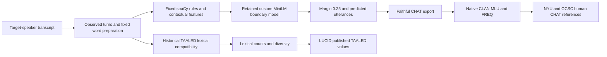
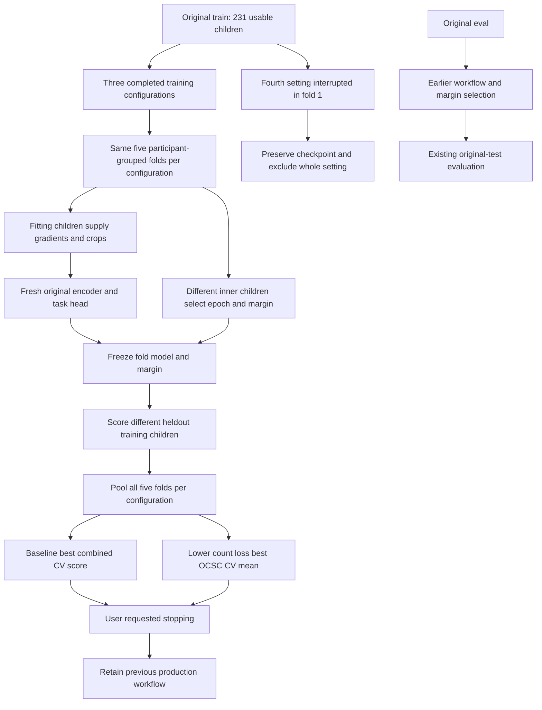

# Current pipeline and completed comparisons

The boundary model uses an off-the-shelf pretrained MiniLM encoder plus our custom
learned rule embedding and gap classifier. Task training updates the encoder and
head jointly. SpaCy and native CLAN are external components. Original human
utterance endings stay outside inference inputs. All words remain preserved.

All15 completed assessments passed role, crop, initialization, frozen-weight,
word-preservation and native-metric checks. No original eval/test child entered
CV recipe comparison. The current search stopped before a new final fit or test.
CV tuning values and existing production-test results describe different fitted
models and evaluation roles. No new model was activated.

LUCID remains a separate lexical benchmark. Its word intervals do not provide gold
utterances or MLU. Agreement reproduces published lexical statistics and does not
establish superiority over a published trained boundary model. Babble/L2 results
are strong; noBarrier and unresolved vocoder remain qualified.
