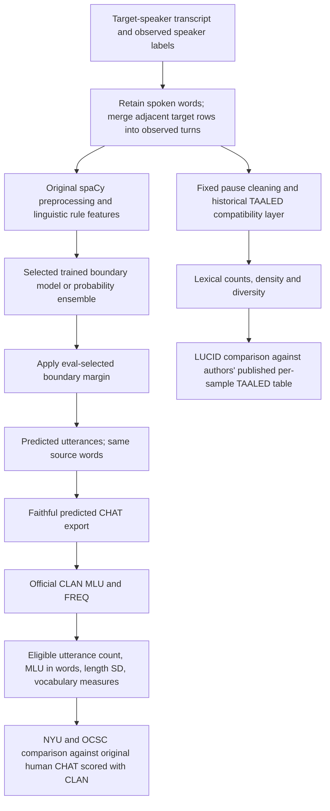
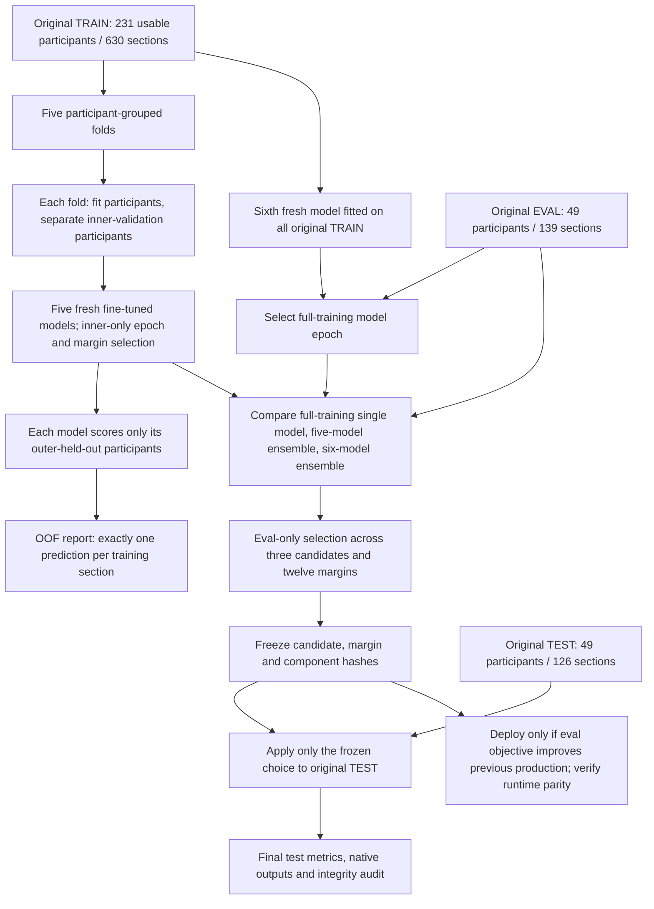

# Pipeline and current model-improvement work

The scope is **transcripts → predicted utterances → language metrics**.
Audio transcription, diarization and the original ten-participant study are deferred.
The report and live status files identify which registered training stages have finished.

At inference, source utterance row endings, human reference cuts and clinical annotation
scopes are withheld from model inputs. During supervised training, reference cuts from
fitting participants supply the target labels. Observed speaker changes define inference contexts.
The prediction export does not invent morphology, retrace, maze or error annotations.
LUCID has lexical reference values; it does not provide gold utterances or MLU.

All original train/eval/test assignments stay fixed and participant-independent.
Every section/crop from a child keeps that child's role for the relevant model.
Original eval/test participants never fit any member's weights. Test results do not
choose a candidate, margin, ensemble weight or deployment. The ensemble's original
training-pool score would not be OOF; only the dedicated held-out fold predictions
are used for that report.

| Component | What is supplied externally | What is ours |
|---|---|---|
| Language preprocessing | Existing spaCy English model | Input policy, word conservation and rule-feature extraction |
| Boundary encoder | Original pretrained Microsoft MiniLM | Task-specific fine-tuning on original training participants |
| Boundary classifier | None | Learned rule embedding and gap classifier; custom training/count loss |
| Model improvement | Standard probability-averaging principle | Registered grouped CV, fresh models, eval selection and runtime routing |
| Lexical calculation | Historical TAALED dictionary/category conventions | Compatibility implementation and fixed pause handling |
| CHAT calculation | Official native CLAN MLU/FREQ executables | Faithful export, cohort/reference alignment, error calculation and audit |

The segmentation model is custom task training built on a pretrained encoder.
It is not a language encoder trained from scratch, and it is not merely an unchanged
pretrained model. Lexical compatibility and native CLAN calculations do not learn
weights from LUCID, eval or test data.
